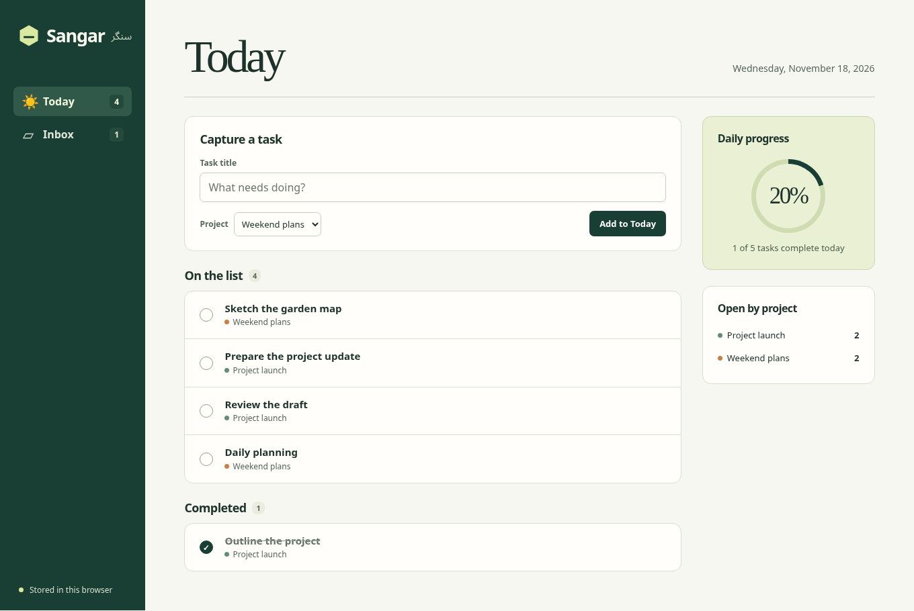

# Sangar

Sangar is a small local task planner. Capture work for today, keep unscheduled tasks in the Inbox, and check off what you finish. The workspace starts with a fictional project launch and weekend plans.



## Run locally

From the repository root, start a static server with Python 3.8 or newer.

```sh
python3 -m http.server 8035 --bind 127.0.0.1 --directory web
```

Open [the local workspace](http://127.0.0.1:8035). A current browser with JavaScript enabled runs the app. It stores tasks under this origin in browser local storage. Stop the server with Ctrl+C.

## Try the capture flow

1. Open **Today** in a fresh browser profile. Three tasks are open and one is complete.
2. Enter **Sketch the garden map**, choose **Weekend plans**, and press **Add to Today**. The task appears at the top. Daily progress shows one of five complete.
3. Reload. The new task stays in the list. Use the circle beside its title to complete it. The task moves to **Completed**, and progress changes to two of five. Select its checkmark to reopen it.
4. Open **Inbox**. Choose **Move to Today** beside **Plan a weekend walk**, then return to **Today** to find it in the list.

Open tasks due on an earlier day carry into Today. Completed tasks appear on their completion date. If browser storage is unavailable, an on-screen message identifies session-only changes.

## Test

With Node.js 20 or newer, run the calendar, validation, and task-selection tests from the repository root.

```sh
node --test tests/tasks.test.mjs
```

## Credits

The Sangar mark and the fictional project and task names are adapted from Ramin Yazdani’s MIT-licensed Sangar demo. The planner and its screenshot were made for this showcase. The original notice is included in [LICENSE](LICENSE).
